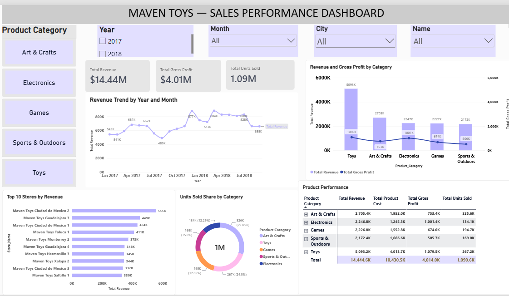

# Maven-toys-sales-powerbi
Power BI analysis of Maven Toys revenue, gross profit, product categories and store performance.
# Maven Toys — Sales Performance Analysis

## Objective

Build an interactive Power BI report to analyse sales, gross profit and product performance across stores, helping retail managers identify trends and opportunities for further investigation.

## Dashboard Preview

## Analysis Performed

- **Power Query:** Imported Sales, Products, Stores and Inventory CSV files. Cleaned currency symbols from product prices and costs, and corrected numeric and date data types.
- **Data modelling:** Connected Products and Stores to both Sales and Inventory using one-to-many relationships with single-direction filtering.
- **DAX calculated columns:** Calculated revenue as units * product price, product cost as units * unit cost, and gross profit as revenue − cost. Used `RELATED()` to retrieve prices and costs from the Products table.
- **DAX measures:** Created Total Revenue, Total Product Cost, Total Gross Profit and Total Units Sold using `SUM()`, and Total Sales Transactions using `DISTINCTCOUNT()`.
- **Visual analysis:** Built a monthly revenue trend, revenue and profit comparison by category, top 10 stores chart, units sold share donut and product performance matrix. Added year, month, category, city and store slicers.

## Key Findings

Across January 2017–September 2018:

- Total revenue was approximately **$14.44 million**, with **$4.01 million gross profit** and **1.09 million units sold**.
- Overall gross profit margin was approximately **27.8%**, calculated as total gross profit divided by total revenue.
- **Toys** generated the highest revenue at approximately **$5.09 million**, contributing **35.3%** of total revenue.
- **Electronics** achieved approximately **44.6% gross profit margin**, compared with **21.2% for Toys**.
- **Art & Crafts** contributed approximately **29.9% of total units sold**, the largest category share by volume.

## Recommendations

- Review product availability in Toys and Art & Crafts because of their strong revenue and sales volume.
- Investigate opportunities to grow Electronics sales while monitoring demand and profitability.
- Review product-level costs and sales mix within Toys to understand its lower margin compared with Electronics.
- Compare high-performing stores with other stores to identify practices worth testing.

## Limitations

The dataset covers January 2017–September 2018, so annual comparisons should use matching periods, such as January–September. Revenue and gross profit use the supplied product prices and costs; historical price changes and discounts are not captured. Gross profit excludes operating expenses and is therefore not net profit.
